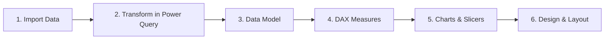

# Hospital Wait Time Dashboard (Power BI)

**An interactive Power BI dashboard I built during the Advanced Power BI course on Hash Plus — analyzing patient waiting times across hospitals, departments, and months.**

---

## Table of Contents
- [About the Course](#about-the-course)
- [What the Project Contains](#what-the-project-contains)
- [How I Built It](#how-i-built-it)
- [Key Metrics](#key-metrics)
- [Insights](#insights)
- [Dashboard](#dashboard)
- [Skills Demonstrated](#skills-demonstrated)
- [Author](#author)

---

## About the Course

This project is one of the dashboards I built for the **Advanced Power BI** course offered by [Hash Plus](https://hashplus.com), an Arabic online learning platform. It is the next step in my data analysis learning path, after my earlier Power BI projects — [Hospital Patients Dashboard](https://github.com/wajd-cs/hospital-dashboard-powerbi) and [Car Rental Dashboard](https://github.com/wajd-cs/car-rental-dashboard-powerbi) — moving from a single flat table to a multi-table data model with DAX measures.

During the course, I built this dashboard to apply what I learned about data modeling, relationships, and DAX.

## What the Project Contains

A Power BI report built on a hospital visits dataset for 2025 (data in Arabic), made of five related tables:

| Table | Rows | Description |
|---|---|---|
| Visit | 1,000 | Visit date, arrival time, triage time, waiting time, treatment time (minutes), severity level, and visit status |
| Patient | 500 | Name, gender, age, city, nationality, and insurance type |
| Doctor | 84 | Doctor name, hospital, department, and shift (morning, evening, night) |
| Department | 7 | Emergency, Pediatrics, Cardiology, Orthopedics, Internal Medicine, Surgery, Obstetrics & Gynecology |
| Hospital | 12 | Hospital name, city, region, and bed capacity |

The dashboard includes:

- **6 KPI cards** — number of hospitals, doctors, and patients, average waiting time, and the count and percentage of patients seen within 30 minutes
- **3 charts** — average waiting time by hospital (bar chart), average waiting time by department (column chart), and patients over time (bar chart with a date drill-down)
- **3 slicers** — filter the whole report by month, department, or hospital

## How I Built It

**1. Imported the data** from an Excel workbook with five sheets into Power BI.

**2. Transformed it in Power Query** — promoted the first row to headers and set the correct data type for each column (text for IDs and names, date for the visit date, time for the arrival time, whole numbers for durations and capacity).

**3. Built the data model** — connected the Visit table (the fact table) to Patient, Department, and Hospital through their ID columns, so any filter on a hospital, department, or patient flows through to the visits.

**4. Wrote DAX measures** for every KPI:

| KPI | DAX |
|---|---|
| Average waiting time | `AVERAGEA('Visit'[Wait Time (min)])` |
| Number of patients | `COUNTA('Patient'[Patient ID])` |
| Number of doctors | `COUNTA('Doctor'[Doctor ID])` |
| Number of hospitals | `COUNTA('Hospital'[Hospital ID])` |
| Patients seen within 30 min | `CALCULATE(COUNTROWS('Patient'), 'Visit'[Wait Time (min)] <= 30)` |
| % seen within 30 min | `DIVIDE([Patients seen within 30 min], [Number of patients])` |

**5. Created charts** that answer three questions, and added slicers:

| Chart | Type | Question |
|---|---|---|
| Hospitals with the longest wait | Bar | Which hospitals keep patients waiting the longest? |
| Departments under the most pressure | Column | Which departments have the longest waits? |
| Patients over time | Bar (date drill-down) | Which months and days are the busiest? |

Slicers for month, department, and hospital filter every card and chart on the page at once.

**6. Designed the layout** — KPI cards on top, charts and slicers below, with a calm navy and sand theme.

## Key Metrics

| Metric | Value |
|---|---|
| Number of visits | 1,000 |
| Number of patients | 500 |
| Number of doctors | 84 |
| Number of hospitals | 12 |
| Departments | 7 |
| Average waiting time | ~62 minutes |
| Patients seen within 30 minutes | 154 (30.8%) |

## Insights

- **Patients wait about an hour on average** (62 minutes), and waits range from 5 minutes up to 2 hours — only 154 patients (30.8%) were seen within 30 minutes.
- **Al-Mustaqbal Hospital (Abha) and Al-Nukhba Hospital (Riyadh) have the longest waits**, at around 69 minutes each, while Al-Salam Hospital (Jeddah) has the shortest at about 57 minutes.
- **Obstetrics & Gynecology is the department under the most pressure** (66 minutes on average), followed by Internal Medicine (65 minutes), while Surgery has the shortest wait (58 minutes).
- **March is the busiest month** (87 patients), while September is the quietest (54 patients).

## Dashboard

## Skills Demonstrated

- **Power Query** — importing multiple sheets and preparing them with correct headers and data types
- **Data Modeling** — building relationships between a fact table and four dimension tables
- **DAX** — writing measures with `CALCULATE`, `DIVIDE`, `COUNTA`, and `AVERAGEA`
- **Data Visualization** — choosing chart types that match each business question
- **Interactive Filtering** — slicers and a date drill-down that filter the entire report
- **Dashboard Design** — organizing KPIs, charts, and filters into one clear, consistent layout
- **Business Thinking** — turning waiting-time data into observations a hospital could act on

## Author

**Wajd Alluhaibi**
Computer Science Student | Data Analysis & Software Development

